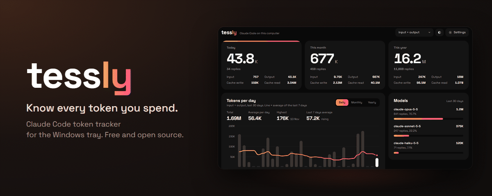
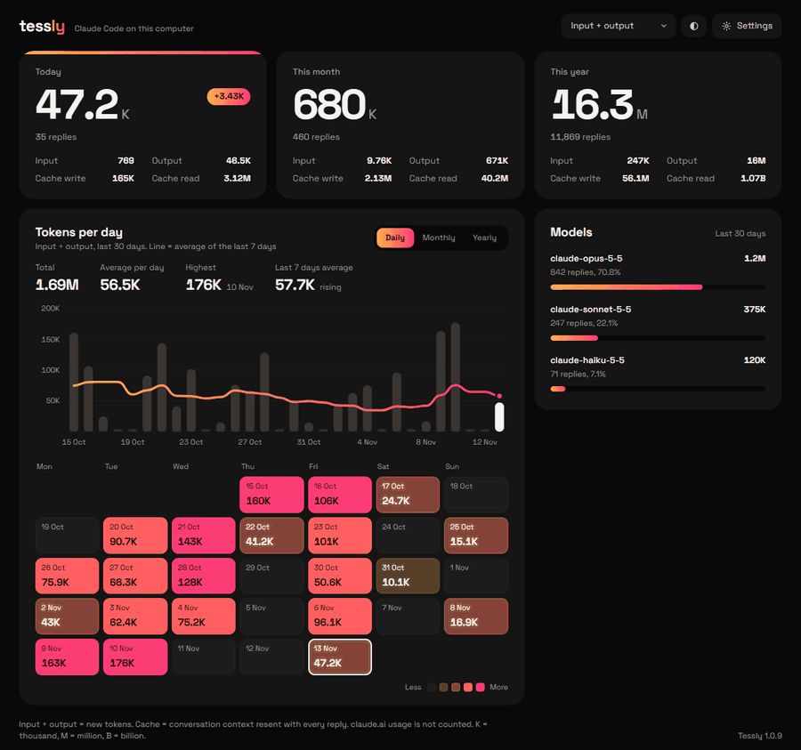

<p align="center">
  
</p>

<p align="center">
  <a href="https://github.com/arifmardhatillah/Tessly/releases/latest"></a>
  <a href="https://github.com/arifmardhatillah/Tessly/releases"></a>
  
  <a href="LICENSE"></a>
</p>

<p align="center">
  <a href="https://github.com/arifmardhatillah/Tessly/releases/latest"></a>
</p>

<p align="center"><a href="README.md">English</a> · <b>Bahasa Indonesia</b></p>

Tessly adalah aplikasi Windows gratis yang menampilkan berapa banyak token yang dipakai **Claude Code** di komputer Anda, per hari, per bulan, dan per tahun. Aplikasi berjalan di system tray, dan angkanya naik begitu Claude Code selesai membalas.

## Kenapa Tessly

- **Langsung.** Total naik begitu Claude Code selesai membalas, tanpa perlu muat ulang.
- **Pribadi.** Semua data tetap di komputer Anda. Yang disimpan hanya jumlah token, bukan isi percakapan.
- **Gratis dan open source.** Berlisensi MIT, dibuat dari kode di repo ini.

<sub>Spanduk dan tangkapan layar memakai data contoh.</sub>

## Unduh

1. Buka [rilis terbaru](https://github.com/arifmardhatillah/Tessly/releases/latest) dan unduh `Tessly-Setup-x.y.z.exe`.
2. Jalankan. Pemasangan hanya untuk akun Windows Anda, tanpa hak admin.

Syarat: Windows 10 atau 11, dan [Claude Code](https://docs.anthropic.com/en/docs/claude-code) dipakai di komputer yang sama.

### "Windows protected your PC"

Installer belum ditandatangani (code signing), jadi Windows SmartScreen bisa menampilkan peringatan biru saat pertama kali dijalankan. Klik **More info**, lalu **Run anyway**. Seluruh kode sumber ada di repo ini, dan setiap installer dibuat dari kode tersebut.

## Yang ditampilkan

<p align="center"></p>

- Token hari ini, bulan ini, dan tahun ini, dirinci menjadi input, output, cache tulis, dan cache baca.
- Grafik harian, bulanan, atau tahunan dengan garis tren rata-rata.
- Kalender warna untuk melihat hari tersibuk.
- Pemakaian per model.
- Filter jenis token. "Input + output" (bawaan) hanya menghitung token baru. Cache baca biasanya jauh lebih besar, karena seluruh percakapan dikirim ulang di setiap balasan.

Tampilan tersedia dalam bahasa Indonesia dan Inggris (Pengaturan > Bahasa). Menu tray dan notifikasi ikut berganti.

## Privasi

Semua data tetap di komputer Anda. Tessly membaca log sesi yang memang sudah ditulis Claude Code di `%USERPROFILE%\.claude\projects` (juga `~/.config/claude/projects`, atau `CLAUDE_CONFIG_DIR` bila diatur). Dari log itu hanya jumlah token per tanggal dan model yang disimpan. Isi percakapan, nama file, dan folder proyek tidak pernah disimpan.

Tessly tidak mengirim data Anda ke mana pun. Satu-satunya akses internet adalah mengecek GitHub Releases repo ini untuk update aplikasi.

**Tidak termasuk:** pemakaian claude.ai (web dan aplikasi chat). Data itu hanya ada di server Anthropic.

## Cara kerja

1. Begitu Claude Code menulis log, Windows memberi tahu Tessly (`fs.watch`), lalu hanya bagian file yang baru yang dibaca. Sebagai cadangan, semua log diperiksa ulang tiap 30 detik.
2. Satu balasan model bisa tercatat beberapa kali di log, jadi setiap balasan dihitung satu kali berdasarkan `message.id` + `requestId`.
3. Total per (tanggal, model) disimpan di `%APPDATA%\Tessly\history.json`. Secara bawaan Claude Code menghapus log yang lebih tua dari 30 hari. Tessly menyimpan nilai tertinggi yang pernah terbaca, jadi riwayat tetap aman setelah log terhapus. Kalau ingin log Claude Code disimpan lebih lama, tambahkan `"cleanupPeriodDays": 365` di `~/.claude/settings.json`.

## Update

Tessly mengecek versi baru saat menyala, saat jendelanya dibuka atau diklik, dan setiap 10 menit. Kalau ada, popup menawarkan untuk mengunduh dan memasangnya. Bisa juga lewat Pengaturan > Cek update.

## Uninstall

Pengaturan Windows > Aplikasi > Aplikasi terinstal > Tessly > Uninstall. Untuk ikut menghapus riwayat yang tersimpan, hapus folder `%APPDATA%\Tessly`.

## Pengembangan

```bash
npm install
npm run test:scan   # uji pembaca log tanpa Electron
npm start           # jalankan aplikasi
npm run dist        # buat installer di folder dist/ (tanpa menerbitkan)
```

Kalau dijalankan dari terminal VS Code dan muncul error `requestSingleInstanceLock`, hapus dulu variabel `ELECTRON_RUN_AS_NODE` (Bash: `env -u ELECTRON_RUN_AS_NODE npm start`).

Variabel untuk pengembangan:

| Variabel | Fungsi |
|---|---|
| `CLAUDE_CONFIG_DIR=folder` | Membaca log uji, bukan log asli. |
| `TM_SHOT=hasil.png` | Menyimpan tangkapan layar jendela lalu keluar. |
| `TM_JS="..."` | Menjalankan skrip di halaman sebelum dipotret, misalnya untuk mengklik tab. |
| `TM_FAKE_UPDATE=9.9.9` | Menampilkan popup update. `TM_FAKE_STATUS` (`downloading`, `ready`, `installing`) memilih tahapnya. |
| `TM_FRAMES=120` | Bersama `TM_SHOT`, menyimpan sejumlah bingkai berurutan (`hasil-000.png`, ...) tiap `TM_FRAME_MS` ms (bawaan 80), untuk GIF demo. |

Struktur:

- `src/scanner.js`: membaca log secara bertahap, membuang duplikat, menjumlahkan per tanggal dan model
- `src/history.js`: riwayat total per tanggal dan model di `history.json`
- `src/main.js`: tray, jendela, pemantauan log, pengaturan
- `src/updater.js`: cek dan pasang update dari GitHub Releases
- `renderer/`: dashboard (HTML/CSS/JS biasa, grafik SVG). Semua teks antarmuka ada di `renderer/i18n.js`, komponen dropdown di `renderer/dropdown.js`.

### Menerbitkan versi baru

1. Naikkan `version` di `package.json`.
2. Tulis perubahan di `build/release-notes.md` (isinya tampil di popup).
3. Buat token GitHub (fine-grained) untuk repo ini dengan izin *Contents: Read and write*.
4. Di PowerShell, dari folder proyek, jalankan `powershell -ExecutionPolicy Bypass -File .\release.ps1`. Skrip akan meminta token; token tidak terlihat saat ditempel, itu normal.

## Lisensi

[MIT](LICENSE). Font Space Grotesk yang disertakan berlisensi [SIL Open Font License 1.1](renderer/fonts/OFL.txt).

Tessly adalah proyek independen, tidak berafiliasi dengan, tidak didukung, dan tidak disponsori oleh Anthropic. "Claude" dan "Claude Code" adalah merek dagang Anthropic, disebut di sini hanya untuk menjelaskan aplikasi apa yang dipantau.
