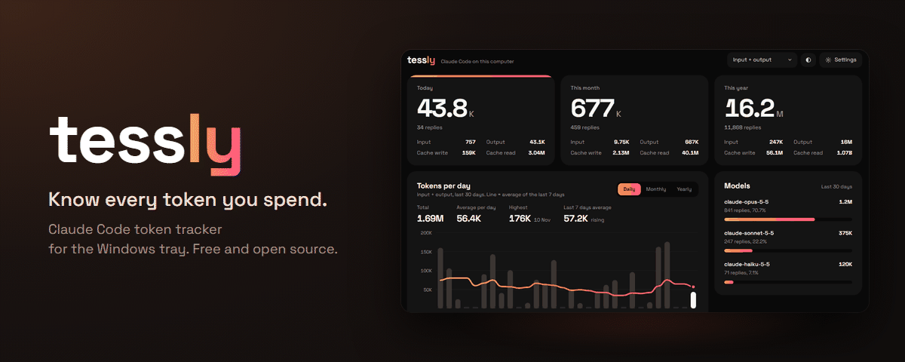
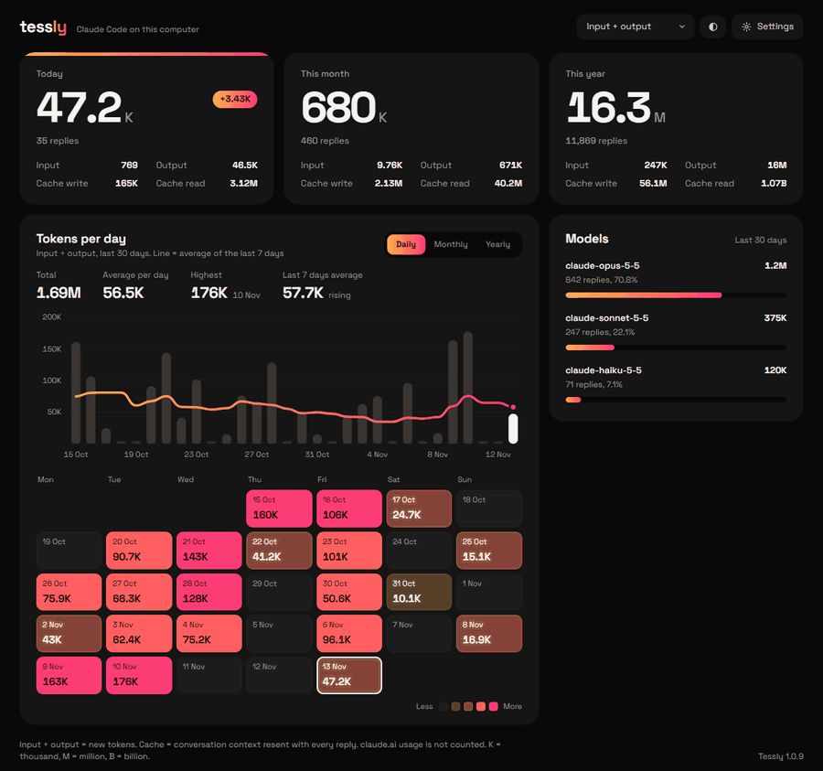

  

  
  
  
  

  

<b>English</b> · <a href="README.id.md">Bahasa Indonesia</a>

  <b>Tessly is a small Windows tray app that totals the tokens Claude Code uses on your computer, today, this month and this year, and updates the moment a reply finishes.</b>

## Why Tessly

Claude Code reports usage one session at a time. Tessly adds every session and every project together, keeps the history, and shows how your usage grows over days and months. Everything is read from files already on your computer, so it needs no account, no API key and no setup.

## Features

<table>
  <tr>
    <td width="33%" valign="top"><b>Live totals</b> Today, this month and this year, each split into input, output, cache write and cache read.</td>
    <td width="33%" valign="top"><b>Charts and trends</b> Daily, monthly or yearly bars with a moving-average line, so a busy week stands out.</td>
    <td width="33%" valign="top"><b>Usage calendar</b> A color calendar of the last weeks shows your busiest days at a glance.</td>
  </tr>
  <tr>
    <td valign="top"><b>Per model</b> See how your tokens divide between Opus, Sonnet and Haiku.</td>
    <td valign="top"><b>Private by design</b> Only token counts are stored. Your conversations are never saved or sent anywhere.</td>
    <td valign="top"><b>Quietly up to date</b> Light and dark mode, English and Indonesian, and one-click updates from inside the app.</td>
  </tr>
</table>

The banner and tour use sample data.

## Get started

1. Download `Tessly-Setup-x.y.z.exe` from the [latest release](https://github.com/arifmardhatillah/Tessly/releases/latest).
2. Run it. It installs for your Windows account only, no admin rights needed.
3. Use Claude Code as usual. Click the Tessly icon in the system tray to open the dashboard.

**Requirements:** Windows 10 or 11, with [Claude Code](https://docs.anthropic.com/en/docs/claude-code) used on the same computer.

> [!NOTE]
> The installer is not code-signed yet, so Windows SmartScreen may show "Windows protected your PC" the first time. Click **More info**, then **Run anyway**. Every installer is built from the source code in this repository.

## Privacy

- **Reads local files only.** Tessly reads the session logs Claude Code already writes to `%USERPROFILE%\.claude\projects`.
- **Stores numbers only.** It keeps token counts per date and model, never conversation text, file names or project folders.
- **Sends nothing.** Its only network request is checking this repository's releases for a new version.

## FAQ

<b>Why are cache reads so much larger than input and output?</b>

 
Claude Code resends the whole conversation with every reply, and most of it is read from cache. That is why the default filter, "Input + output", counts only new tokens. You can switch the filter at the top of the dashboard.

<b>Does it count usage on claude.ai?</b>

 
No. Chats on claude.ai (web and desktop) are stored only on Anthropic's servers, so Tessly cannot see them.

<b>What happens when Claude Code deletes old logs?</b>

 
Claude Code deletes logs older than 30 days by default. Tessly saves its own totals in <code>%APPDATA%\Tessly\history.json</code>, so your history stays. To keep Claude Code's logs longer as well, add <code>"cleanupPeriodDays": 365</code> to <code>~/.claude/settings.json</code>.

<b>How do updates work?</b>

 
Tessly checks for a new version when it starts, when you open its window, and every 10 minutes. When one is ready, a popup offers to install it, and a progress window shows while it installs. You can also check from Settings.

<b>How do I uninstall it?</b>

 
Windows Settings > Apps > Installed apps > Tessly > Uninstall. To remove your saved history too, delete the <code>%APPDATA%\Tessly</code> folder.

## Contributing

Bug reports and ideas are welcome in [Issues](https://github.com/arifmardhatillah/Tessly/issues). To build Tessly yourself or send a change, see [CONTRIBUTING.md](CONTRIBUTING.md).

## License

[MIT](LICENSE) © Arif Mardhatillah. The bundled Space Grotesk font is licensed under the [SIL Open Font License 1.1](renderer/fonts/OFL.txt).

Tessly is an independent project. It is not affiliated with, endorsed by or sponsored by Anthropic. "Claude" and "Claude Code" are trademarks of Anthropic, used here only to describe what the app works with.
