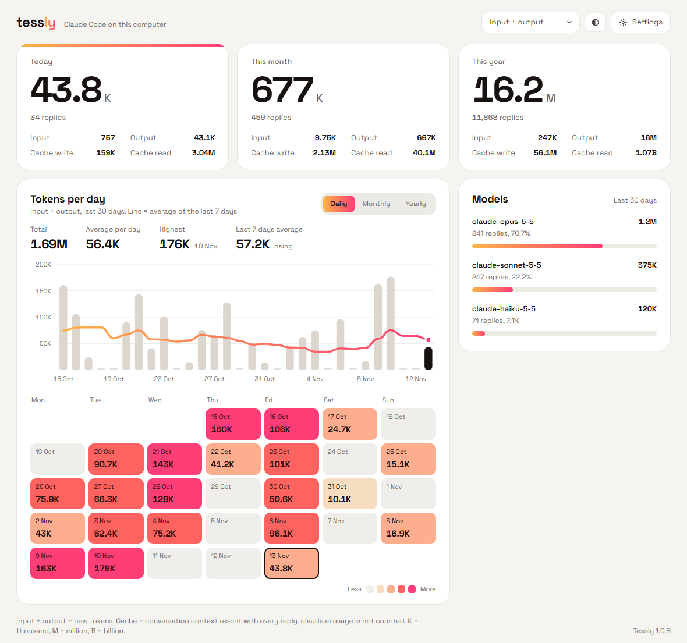

# Tessly: AI Token Tracker

*Know every token you spend.*

**English** · [Bahasa Indonesia](README.id.md)

Tessly is a free Windows app that shows how many tokens **Claude Code** uses on your computer, by day, month and year. It sits in the system tray, and the numbers update the moment Claude Code finishes a reply.

<picture>
  <source media="(prefers-color-scheme: dark)" srcset="docs/screenshot-dark.png">
  
</picture>

<sub>Screenshot with sample data.</sub>

## Download

1. Open the [latest release](https://github.com/arifmardhatillah/Tessly/releases/latest) and download `Tessly-Setup-x.y.z.exe`.
2. Run it. It installs for your user account only, no admin rights needed.

Requirements: Windows 10 or 11, and [Claude Code](https://docs.anthropic.com/en/docs/claude-code) used on the same computer.

### "Windows protected your PC"

The installer is not code-signed yet, so Windows SmartScreen may show a blue warning the first time. Click **More info**, then **Run anyway**. The full source code is in this repository, and every installer is built from it.

## What it shows

- Tokens today, this month and this year, split into input, output, cache write and cache read.
- A daily, monthly or yearly chart with a moving-average trend line.
- A color calendar of your busiest days.
- Usage per model.
- A filter for which tokens to count. "Input + output" (the default) shows new tokens only. Cache reads are usually much larger, because the whole conversation is resent with every reply.

The app is available in English and Indonesian (Settings > Language).

## Privacy

Everything stays on your computer. Tessly reads the session logs Claude Code already writes to `%USERPROFILE%\.claude\projects` (and `~/.config/claude/projects`, or `CLAUDE_CONFIG_DIR` if set). From those logs it keeps only token counts per date and model. It never stores conversation text, file names or project folders.

Tessly does not send your data anywhere. Its only network request is a check of this repository's GitHub Releases for app updates.

**Not counted:** usage on claude.ai (web and desktop chat). That data only exists on Anthropic's servers.

## How it works

1. Windows tells Tessly when Claude Code writes to a log (`fs.watch`). Tessly then reads only the new part of that file. As a fallback, all logs are rescanned every 30 seconds.
2. One model reply can appear in the log several times, so each reply is counted once by `message.id` + `requestId`.
3. Totals per (date, model) are saved in `%APPDATA%\Tessly\history.json`. By default Claude Code deletes logs older than 30 days. Tessly keeps the highest value it has seen, so your history survives that cleanup. To keep Claude Code's own logs longer, add `"cleanupPeriodDays": 365` to `~/.claude/settings.json`.

## Updates

Tessly checks for a new version when it starts, when you open or click its window, and every 10 minutes. When one is available, a popup offers to download and install it. You can also do this from Settings > Check for updates.

## Uninstall

Windows Settings > Apps > Installed apps > Tessly > Uninstall. To remove your saved history as well, delete `%APPDATA%\Tessly`.

## Development

```bash
npm install
npm run test:scan   # test the log reader without Electron
npm start           # run the app
npm run dist        # build the installer into dist/ (without publishing)
```

If you start it from the VS Code terminal and get a `requestSingleInstanceLock` error, unset `ELECTRON_RUN_AS_NODE` first (Bash: `env -u ELECTRON_RUN_AS_NODE npm start`).

Development hooks:

| Variable | Effect |
|---|---|
| `CLAUDE_CONFIG_DIR=folder` | Read test logs instead of your real ones. |
| `TM_SHOT=out.png` | Save a screenshot of the window and quit. |
| `TM_JS="..."` | Run a script in the page before the screenshot, for example to click a tab. |
| `TM_FAKE_UPDATE=9.9.9` | Show the update popup. `TM_FAKE_STATUS` (`downloading`, `ready`, `installing`) picks the stage. |

Project layout:

- `src/scanner.js`: reads logs incrementally, removes duplicates, sums per date and model
- `src/history.js`: per date and model totals in `history.json`
- `src/main.js`: tray, window, log watching, settings
- `src/updater.js`: update checks and installs from GitHub Releases
- `renderer/`: the dashboard (plain HTML, CSS and JS, SVG charts). All UI text is in `renderer/i18n.js`; the dropdown component is in `renderer/dropdown.js`.

### Publishing a release

1. Bump `version` in `package.json`.
2. Write the changes in `build/release-notes.md` (shown in the update popup).
3. Create a fine-grained GitHub token for the repository with *Contents: Read and write*.
4. In PowerShell, from the project folder, run `powershell -ExecutionPolicy Bypass -File .\release.ps1`. The script asks for the token; it is not shown while you paste it.

## License

[MIT](LICENSE). The bundled Space Grotesk font is licensed under the [SIL Open Font License 1.1](renderer/fonts/OFL.txt).

Tessly is an independent project. It is not affiliated with, endorsed by or sponsored by Anthropic. "Claude" and "Claude Code" are trademarks of Anthropic, used here only to describe what the app works with.
